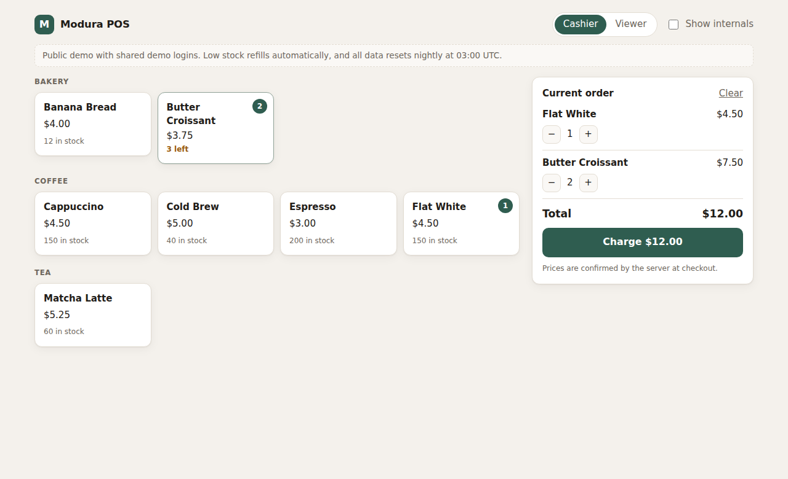
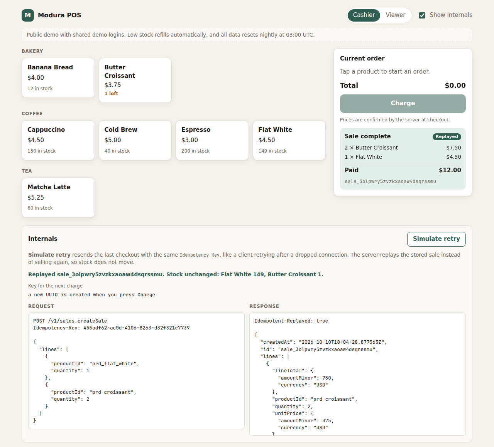
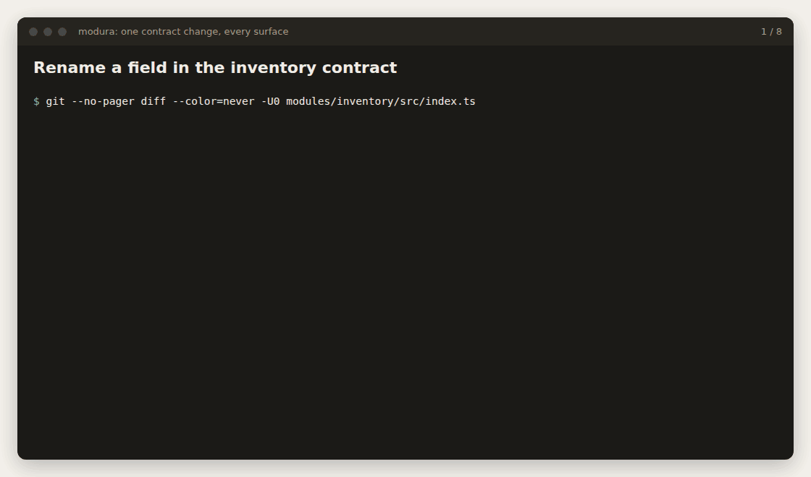
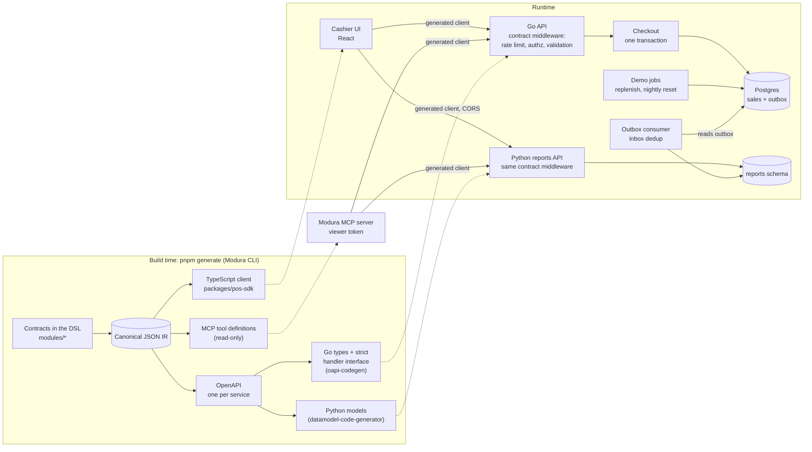

# Modura POS

A point-of-sale application built on [Modura](https://github.com/tonidy/modura-platform), a contract-first platform. Its business operations are written once in Modura's TypeScript DSL, and Modura generates an OpenAPI document per service, a typed TypeScript client, Go server interfaces, Python models and read-only MCP tools from them. The cashier UI talks to the servers only through that generated client.

The part worth inspecting is checkout. `sales.createSale` deducts stock exactly once, even when a client retries after a timeout or two registers sell the last croissant at the same moment.



**Live demo:** not deployed yet. Everything runs locally in a few minutes, and the runbook for a public demo is ready ([docs/deploy.md](docs/deploy.md)).

## A five-minute walkthrough

Requirements: Node 24 and pnpm 12 (pinned in `mise.toml`), Go 1.27, uv (it fetches Python 3.14 itself), and Docker or Podman with Compose. The platform comes from npm (`@modura/*`), so no other checkout is needed.

```sh
pnpm install
pnpm db:up && pnpm db:reset    # Postgres on localhost:55433, migrated and seeded
pnpm api                       # Go API on :8080, in one terminal
pnpm reports                   # Python reports service on :8090, in another
pnpm web                       # cashier UI on http://localhost:5173, in a third
```

1. **Sell something.** Tap Butter Croissant twice and Flat White once, then Charge. The receipt is priced by the server from the catalog, and the croissant drops to "1 left".
2. **Retry it.** Turn on *Show internals* and press *Simulate retry*. The UI resends the last checkout with the same `Idempotency-Key`, the way a client would after a dropped connection. The server replays the stored sale (`Idempotent-Replayed: true`) and stock does not move.
3. **Oversell it.** Add two croissants when one is left and charge. The server answers `sales.INSUFFICIENT_STOCK` with per-line details, and nothing is written.
4. **Switch to Viewer.** Browsing works. Charging comes back `FORBIDDEN`, because the contract says `sales.createSale` requires `sales.write`, and the server enforces exactly that.
5. **Look at Today.** The panel below the till shows today's sales, revenue and best sellers. It comes from a different service, in Python, which learned about each sale from an event. The replayed checkout from step 2 is not counted twice. Stop `pnpm reports` and selling still works; only the panel complains.



### One contract change, every surface



Renaming one field in the inventory contract: `pnpm generate` first refuses because the change breaks clients and the version was not bumped. After the bump, the IR, OpenAPI, client, MCP tools and Go interfaces change in one diff, a second run changes nothing, and the stale UI call site and Go handler stop compiling until they are fixed.

The GIF is rendered from the real output of [`scripts/demo-schema-change.sh`](scripts/demo-schema-change.sh), which runs in a throwaway worktree and fails if any step behaves differently.

### Why you can trust checkout

The claim is backed by tests against real Postgres, each response validated against the generated OpenAPI ([`checkout_test.go`](apps/sales-go/internal/httpapi/checkout_test.go)):

- 20 concurrent buyers, 3 croissants: exactly 3 sales, stock 0, movements add up.
- 10 concurrent retries with one key: one sale, one original response, nine replays.
- Multi-item sales in opposite line orders: no deadlocks.
- A retry that arrives while the original is still running waits and replays it, even when the original took the last unit. If the original rolls back, the retry takes over. If it waits too long, it gets a retryable `IDEMPOTENCY_IN_PROGRESS`.
- Rejected checkouts write nothing and leave the key free.

The suite passes ten times in a row under `go test -race`. The key design decision, claiming the idempotency key before touching stock, was checked by reversing it: the in-flight test then fails with exactly the bug it guards against. See [ADR-0004](docs/adr/0004-create-sale-idempotency.md).

### Two services, two languages, one contract

Every module belongs to exactly one service, declared in [`modura.config.ts`](modura.config.ts):

| Service | Language | Modules | OpenAPI |
|---|---|---|---|
| `sales-go` | Go | catalog, inventory, sales | [`sales-go.json`](generated/openapi/sales-go.json) |
| `reports-py` | Python (uv, FastAPI) | reports | [`reports-py.json`](generated/openapi/reports-py.json) |

Each service gets an OpenAPI document with only its own operations, so Go implements nothing of Python's and has no reference to it (a test checks this). The generated client knows which service owns each operation and calls it directly; nothing forwards requests. The Python service allows the UI's origin through CORS, with an explicit allowlist.

Reports never call Go. Checkout writes a `sales.saleCompleted` event into an outbox table in the same transaction as the sale, and the Python consumer reads it from there. Delivery is at least once, so an inbox table makes duplicates harmless, and the consumer tracks a transaction-id horizon instead of a row id, so an event that commits late is never skipped. Every answer carries `asOf`, so the lag is visible. Both properties are tested, and removing either safeguard on purpose makes its test fail ([ADR-0011](docs/adr/0011-reports-service.md)).

### Contract history and MCP

The POS keeps its contract's release history in git with Modura's file registry: [`contracts/releases`](contracts/releases), one file per release, checked append-only in CI.

```sh
pnpm modura publish                              # writes the next release file; commit it
pnpm modura compat --against registry            # Compatible with release 1.
pnpm modura registry verify --since origin/main  # what CI runs on pull requests
```

Modura's MCP server exposes the catalog, stock and sales reports to AI assistants as read-only tools, using the viewer token. Each tool goes to the service that owns it. For Claude Code or Claude Desktop:

```json
{
  "mcpServers": {
    "modura-pos": {
      "command": "pnpm",
      "args": ["-s", "--dir", "/path/to/modura-pos", "mcp"],
      "env": {
        "MODURA_API_URL": "http://localhost:8080",
        "MODURA_SERVICE_URLS": "{\"reports-py\":\"http://localhost:8090\"}"
      }
    }
  }
}
```

The E2E suite checks that an assistant cannot sell even with a tampered tool list that relabels checkout as read-only: the API refuses the viewer token.

## Architecture



The Go and Python middlewares read permissions (`x-modura-requires`) and operation kind (`x-modura-kind`) straight from their generated OpenAPI documents, so authorization and validation follow the contract rather than handwritten route tables.

## What is shipped and what is not

Nothing is listed as shipped unless a command, a test or a file proves it.

| Shipped | Evidence |
|---|---|
| Go API on `oapi-codegen` interfaces, contract-validated responses | [`contract_test.go`](apps/sales-go/internal/httpapi/contract_test.go) |
| Atomic, idempotent checkout with price snapshots | [`checkout_test.go`](apps/sales-go/internal/httpapi/checkout_test.go) |
| Cashier UI on the generated client only, enforced by lint | [`apps/pos-web`](apps/pos-web), `apps/pos-web/.oxlintrc.json` |
| Browser E2E from UI to Postgres, and an MCP client against the real services | [`tests/e2e`](tests/e2e) |
| Per-IP rate limiting, demo replenishment and nightly reset | [`operations_test.go`](apps/sales-go/internal/httpapi/operations_test.go), [`restock_test.go`](apps/sales-go/internal/store/restock_test.go) |
| Reports service in Python owning its own module, with per-service OpenAPI and client-side routing | [`apps/reports-py`](apps/reports-py), [`ownership_test.go`](apps/sales-go/internal/httpapi/ownership_test.go) |
| Transactional outbox and an idempotent consumer that never skips a late commit or stalls behind other transactions | [`outbox_test.go`](apps/sales-go/internal/httpapi/outbox_test.go), [`test_consumer.py`](apps/reports-py/tests/test_consumer.py) |
| CORS with an origin allowlist, CSP `connect-src` from configuration | [`test_cors.py`](apps/reports-py/tests/test_cors.py), [`operations_test.go`](apps/sales-go/internal/httpapi/operations_test.go) |
| Contract release history in git | [`contracts/releases`](contracts/releases) |
| Fly.io config and runbook | [`fly.toml`](fly.toml), [docs/deploy.md](docs/deploy.md) |

| Not shipped | Status |
|---|---|
| The Python service in the container image | The image holds the Go API and the UI only |
| Public live demo | Needs a hosting account |
| Payments, tax, discounts, multi-currency | Out of scope |

## Development

```sh
pnpm verify        # typecheck, lint, unit tests, Go contract and concurrency tests and Python tests
                   # against Postgres, stale-artifact checks, release-history checks
pnpm e2e           # browser and MCP tests (first run: pnpm --filter @modura/e2e exec playwright install chromium)
pnpm demo          # the schema-change demo, as a check
pnpm generate      # regenerate everything after a contract change
pnpm modura ...    # the Modura CLI; pnpm mcp starts the MCP server
```

Without a database the Go and Python tests are skipped locally. CI sets `MODURA_REQUIRE_DB=1`, which makes them fail instead. The Python tests alone: `pnpm --filter @modura/reports-py test`, or `uv run pytest` in `apps/reports-py`.

To change a contract: edit a module under `modules/`, run `pnpm generate`, and commit the source change and the generated files together. A breaking change needs a module version bump; `pnpm generate` will tell you.

The API can also be used directly. The demo tokens `demo-cashier` and `demo-viewer` are public on purpose: the demo shows authorization boundaries, not authentication.

```sh
curl -si -X POST localhost:8080/v1/sales.createSale \
  -H 'Authorization: Bearer demo-cashier' -H 'Content-Type: application/json' \
  -H "Idempotency-Key: $(uuidgen)" \
  -d '{"lines":[{"productId":"prd_croissant","quantity":2}]}'
```

Regenerating the README media: `pnpm --filter @modura/scripts record-demo` for the GIF, and `capture-ui` for the screenshots (see the header of each script).

## Layout

```text
modules/{catalog,inventory,sales}   the POS contracts, written in Modura's DSL
modules/reports                     sales reports, owned by the Python service
modura.config.ts                    which modules to compile, which service owns each, where outputs go
contracts/releases                  the contract's release history (Modura file registry)
generated/                          checked-in IR, OpenAPI per service and MCP tool definitions
packages/pos-sdk                    the TypeScript client generated from the contracts
apps/sales-go                       Go API: generated interfaces, contract middleware, checkout, outbox, demo jobs
apps/reports-py                     Python reports API (uv, FastAPI): generated models, outbox consumer, projection
apps/pos-web                        React cashier UI
scripts/                            CLI and MCP wrappers, the schema-change demo, README media
tests/e2e                           Playwright: UI to Postgres, MCP client
db/                                 migrations, demo seed, reset script
docs/                               ADRs and the deploy runbook
```

## Decisions

- [ADR-0004](docs/adr/0004-create-sale-idempotency.md) Checkout idempotency, transactions and concurrency
- [ADR-0005](docs/adr/0005-generated-sdk-boundary.md) Generated SDK boundary
- [ADR-0006](docs/adr/0006-money.md) Money representation
- [ADR-0011](docs/adr/0011-reports-service.md) Reports service in Python, fed by an outbox

The platform's decisions, including why the two repositories are separate (ADR-0013), live in [modura-platform](https://github.com/tonidy/modura-platform). ADR numbers are shared between the two repositories, so the gaps here are ADRs that belong to the platform.
